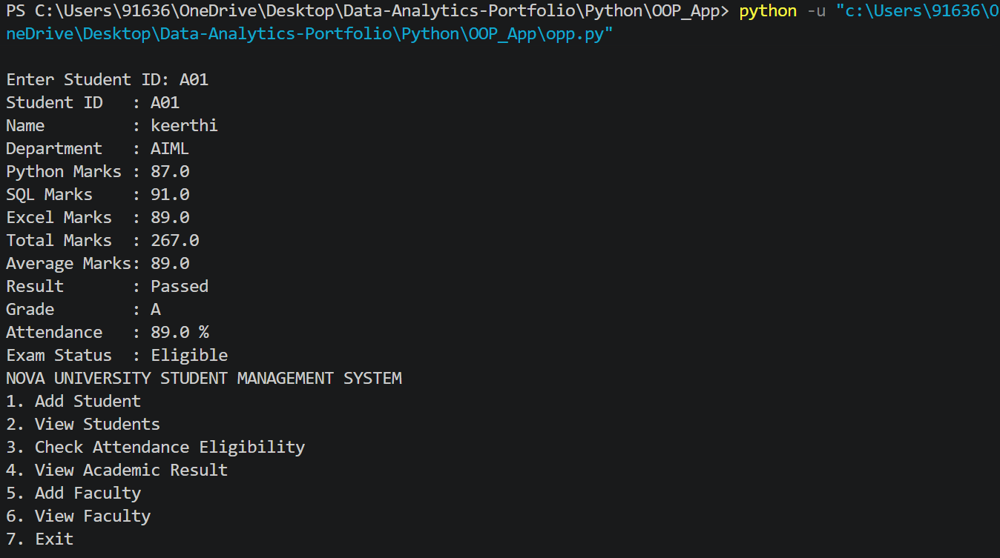

# Nova University – Student Management System

A Python-based console application developed using Object-Oriented Programming (OOP) to manage student and faculty information and perform basic academic checks.

##  Business Problem

Nova University needs a simple and maintainable application to manage student and faculty details and check students' academic performance and examination eligibility.

Managing these details manually can make it difficult to maintain multiple records, calculate academic results consistently, and validate attendance.

This project provides a console-based solution to organize student and faculty information, calculate academic results, and check examination eligibility using Python and OOP concepts.

##  Project Objectives

- Maintain student and faculty information.
- Store student details, including ID, name, email, phone number, department, and attendance.
- Maintain Python, SQL, and Excel marks.
- Calculate total marks and average marks.
- Determine result status and grade.
- Check examination eligibility based on attendance.
- Validate attendance values.
- Handle invalid user inputs.
- Apply OOP concepts to create reusable and maintainable code.

##  Features

- **Student Management:** Add and view student information.
- **Faculty Management:** Add and view faculty information.
- **Academic Information:** Display student academic details.
- **Marks Calculation:** Calculate total and average marks.
- **Result Evaluation:** Determine pass/fail status and grade according to the implemented rules.
- **Attendance Eligibility:** Check whether a student is eligible for the examination.
- **Input Validation:** Reject invalid attendance values.
- **Multiple Records:** Support multiple student records.
- **Error Handling:** Handle invalid user input gracefully.
- **Console Menu:** Interact with the application through menu options.

##  Business Rules

| Rule | Description |
|---|---|
| Attendance Validation | Attendance must be between 0% and 100%. |
| Examination Eligibility | Attendance of 75% or above is eligible for the examination. |
| Passing Criteria | An average mark of 50 or above is considered passed. |
| Academic Calculation | Total marks, average marks, result status, and grade are calculated from subject marks. |
| Input Validation | Invalid input should be handled without unexpected application termination. |

## 🛠️ Technologies Used

- Python 3
- Object-Oriented Programming (OOP)
- Python Classes and Objects
- Console-Based Application

##  OOP Concepts

The application is designed around object-oriented principles.

- **Classes and Objects:** Represent student, faculty, and person-related information.
- **Attributes:** Store details such as name, email, phone number, attendance, and marks.
- **Methods:** Perform operations such as displaying information and calculating academic results.
- **Inheritance:** Can be used to share common person information between student and faculty classes, if implemented.
- **Encapsulation:** Can be used to organize data and related methods within classes, if implemented.
- **Code Reusability:** Reuse academic calculations and business rules rather than repeating the same logic.

Note: Mention inheritance, encapsulation, abstraction, or polymorphism as implemented concepts only when they are actually present in the source code.

##  Application Workflow

1. Start the Python application.
2. Display the console menu.
3. Select an operation.
4. Enter student or faculty information when required.
5. Validate the entered information.
6. View student or faculty records.
7. Check attendance eligibility or academic results.
8. Return to the menu to perform another operation.
9. Select Exit to close the application.

### Expected Menu Options

1. Add Student
2. View Students
3. Check Attendance Eligibility
4. View Academic Result
5. Add Faculty
6. View Faculty
7. Exit

The exact menu options depend on the final implementation.

##  How to Run the Project

### Prerequisites

- Python 3 installed on your system.
- Git installed if you want to clone the repository.

### Step 1: Clone the Repository

```bash
git clone https://github.com/KeerthanaVelliyangiri/Data-Analytics-Portfolio.git
```

### Step 2: Navigate to the Project Folder

```bash
cd Data-Analytics-Portfolio/Python/OOP_App
```

### Step 3: Run the Application

Replace `main.py` with the actual Python entry-point filename in your project, if different.

```bash
python main.py
```

On some Windows systems, you may need to use:

```bash
py main.py
```

##  Testing and Validation

The application should be tested with valid and invalid inputs to verify that the business rules work correctly.

| Test Scenario | Input | Expected Result |
|---|---|---|
| Attendance boundary | 0 | Accepted as valid attendance; not eligible |
| Attendance eligibility | 75 | Accepted; eligible for the examination |
| Maximum attendance | 100 | Accepted; eligible for the examination |
| Invalid attendance | -5 | Rejected as invalid |
| Invalid attendance | 105 | Rejected as invalid |
| Academic calculation | Valid subject marks | Total, average, result, and grade calculated |
| Invalid numeric input | Text instead of a number | Handled gracefully |
| Multiple student records | Add multiple students | Records can be maintained and viewed |

Record the actual test results after running the application.

##  Academic Calculation

The application maintains marks for three subjects:

- Python
- SQL
- Excel

The total marks are calculated by adding the three subject marks.

**Total Marks**

```text
Total = Python Marks + SQL Marks + Excel Marks
```

**Average Marks**

```text
Average = Total Marks / 3
```

**Result Status**

```text
Average >= 50  → Pass
Average < 50   → Fail
```

**Attendance Eligibility**

```text
Attendance >= 75%  → Eligible
Attendance < 75%   → Not Eligible
```

The activity brief does not specify grade boundaries or maximum marks per subject. Use the rules defined in your actual Python implementation.

##  Project Structure

Update the filenames below to match your actual repository.

```text
Data-Analytics-Portfolio/
└── Python/
    └── OOP_App/
        ├── README.md
        ├── oop.py
        └── Screenshot/
            └── screenshot.png
```

##  Application Output

Add screenshots of your actual application output to demonstrate its functionality.

After uploading a screenshot to the `screenshots` folder, you can display it here:

```markdown


```

Suggested screenshots:

- Main menu
- Adding a student
- Viewing student information
- Academic result calculation
- Attendance eligibility check
- Adding and viewing faculty information
- Invalid attendance validation

## 🔮 Future Enhancements

- Add search options for student and faculty records.
- Add update and delete operations.
- Store records permanently using file handling or a database.
- Improve email and phone number validation.
- Add automated unit tests.
- Develop a graphical user interface.

These are potential improvements and are not required by the current activity brief.

## 🎓 Learning Outcomes

Through this project, I practised:

- Applying Object-Oriented Programming in Python.
- Designing classes, attributes, and methods.
- Implementing business rules and academic calculations.
- Validating user input.
- Handling invalid inputs.
- Organizing application logic for readability and reusability.
- Building a practical console-based application.

## 🔗 Project Repository

**GitHub:** [Data-Analytics-Portfolio – OOP_App](https://github.com/KeerthanaVelliyangiri/Data-Analytics-Portfolio/tree/main/Python/OOP_App)

## 📝 Conclusion

The Nova University Student Management System demonstrates how Python and Object-Oriented Programming can be used to organize student and faculty information, calculate academic results, validate attendance, and support basic academic checks through a console-based application.
